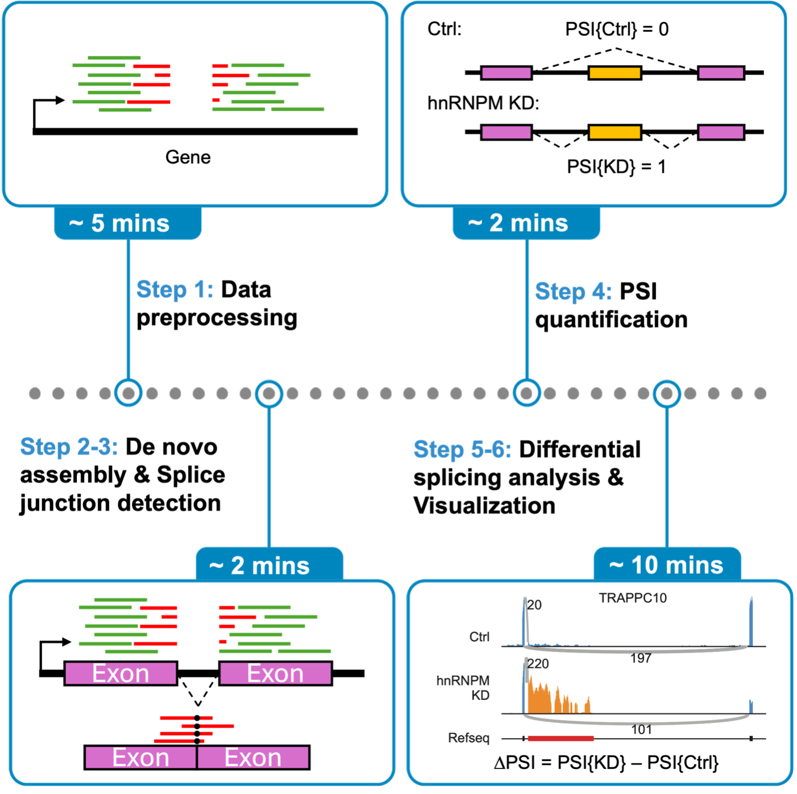

# CryEx

Paper Link: [Star Protocols](https://www.cell.com/star-protocols/fulltext/S2666-1667(26)00584-8) 

CryEx is a Python-based pipeline designed to identify and quantify cryptic exons from RNA-Seq datasets. The pipeline leverages StringTie for transcript assembly and detects cryptic exons.

**Highlights:**

●	A user-friendly python package for CryEx protocol to construct a comprehensive splicing landscape 

●	Identification and quantification of cryptic exons and annotated exons using RNA-Seq data

●	Customizable filtering parameters to enable differential splicing analysis at different resolutions

●	A framework for implementing data preprocessing, analysis, customization and visualization

<p align="center">
  
</p>

## Table of Contents 📚
- [Installation 🔧](#installation-)
- [Usage 🚀](#usage-)
- [Input 📥](#input-)
- [Output 📤](#output-)
- [Troubleshooting 🛠️](#troubleshooting-)

## Installation 🔧 

Installation from the GitHub repository:

```
git clone https://github.com/giovanniquinones/CryEx
cd CryEx/Cryex_pkg

# create a virtual environment from yaml file
conda env create -f cryex_env.yaml
conda activate CryEx_env

# install the package
pip install .
```

Installation from PyPI:

```
pip install CryEx.v2
```

It is recommended to create a virtual environment before using `pip install` to obtain the dependencies.

### Dependencies 📦
- Python 3.10+
- Python packages: NumPy, pandas, pysam, SciPy, and Statsmodels (installed with CryEx)
- External tools: StringTie, bgzip, and tabix (provided by HTSlib)

`subprocess` and `multiprocessing` are part of Python’s standard library; they do
not need to be installed separately.

## Usage 🚀

After installation, you can use the CryEx command line tools. Below is an example of how to run the pipeline:

```
# Check if installed successfully
CryEx_stringtie --help 

# Set input/output paths (run from the Cryex_pkg directory)
FOFN="test_data/fofn.txt"
EXONS="out/exons.gtf"
JXN="out/jxn.bed"
PSI="out/psi.txt"
DIFF="out/diff.txt"
mkdir -p out

# Identify cryptic and annotated exons
CryEx_stringtie -f "$FOFN" -o "$EXONS"

# Calculate splice junction usage
CryEx_junctions -f "$FOFN" -o "$JXN"

# CryEx_junctions creates a sorted, bgzip-compressed "$JXN.gz" and tabix index.
# Calculate PSI
CryEx_psi_calculator -f "$FOFN" -e "$EXONS" -j "$JXN.gz" -o "$PSI"

# Calculate differential splicing
CryEx_diff -f "$FOFN" -p "$PSI" -o "$DIFF"
```

Set `FOFN`, `EXONS`, `JXN`, `PSI`, and `DIFF` to the paths you want to use before
running these commands. An example pipeline is in `test_data/run_pipeline.sh`.
Before running the example, update the BAM paths in `test_data/fofn.txt` to match
your machine. Run the script from the `test_data` directory.

## Input 📥 

FOFN should be tab separated and have the following columns:

```
SAMPLE	    BAM	                    STAR_SJ_OUT	                    GROUP
sample1    /path/to/sample1.bam     /path/to/sample1.SJ.out.tab     CTRL
sample2    /path/to/sample2.bam     /path/to/sample2.SJ.out.tab     KD
sample3    /path/to/sample3.bam     /path/to/sample3.SJ.out.tab     CTRL
sample4	   /path/to/sample4.bam     /path/to/sample4.SJ.out.tab     KD
```

If STAR_SJ_OUT is not provided, fill in with `na`; CryEx then derives junctions
from the BAM file. Keep the metadata header names exactly as shown.
For differential splicing, Cryex will use the 'GROUP' column.

## Output 📤

- CryEx_stringtie will output a standard GTF file with the identified cryptic and annotated exons.
- CryEx_junctions writes the plain-text junction table at the path given to `-o`,
  plus a sorted bgzip-compressed `<output>.gz` and tabix index `<output>.gz.tbi`.
  The PSI command reads the compressed table.

```
chr21	9826943	    9826984	    hte1,hte2,hte3,hte4     10,1,7,11	+
chr21	9827330	    9874067	    hte1,hte2,hte3,hte4     1,0,0,0     +
chr21	9907492	    9908277	    hte1,hte2,hte3,hte4     63,47,35,49	-
chr21	9907462	    9909046	    hte1,hte2,hte3,hte4     1,0,0,0     -
chr21	9908432	    9909046	    hte1,hte2,hte3,hte4     12,19,11,8	-
```

- CryEx_psi_calculator will output a headered TSV file with 12 columns, including
  exon/junction coordinates, inclusion and exclusion counts, sample, and PSI.

```
exon_type	chrom	exon_3ss	exon_5ss	strand	inclusion_n	jxn_inc_n	exc_5ss	exc_3ss	exclusion_n	SAMPLE	PSI
```
- CryEx_diff will output a TSV file with the differential splicing results.

```
exon_type	exon_coords	flanking_jxns	LLR	Pvalue	Sig	DeltaPSI	DIFF	PSIGroup1	PSIGroup2	CovGroup1	CovGroup2	Pvalue_Adj
```

`Sig` is true only when the LLR, absolute delta-PSI, and adjusted-p-value
thresholds are all met.

## Troubleshooting 🛠️

Please submit your issues to the GitHub repository directly (under the Issues tab).

- Problem 1:

It fails to ‘pip install’ and return this error message “module ‘pip._vendor.platformdirs’ has no attribute ‘user_cache_dir’”.

Potential solution: 

•	Try ‘pip3 install’ instead of ‘pip install’

- Problem 2:

If fails to ‘CryEx_stringtie -f fofn.txt -o exons.gtf’ and return this error message “Segmentation fault”.

Potential solution: 

•	Run stringtie on each bam file one by one instead of multiple files in one run and concat the output GTF files.
